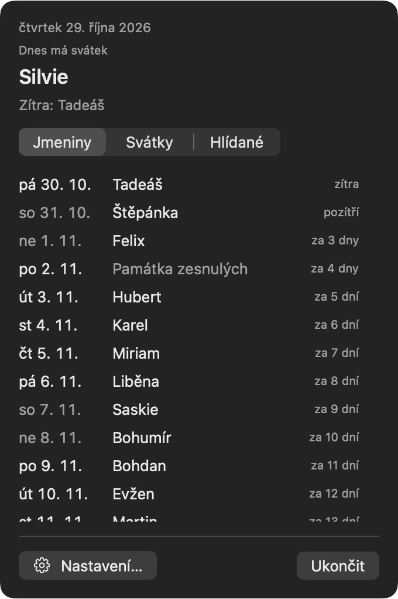
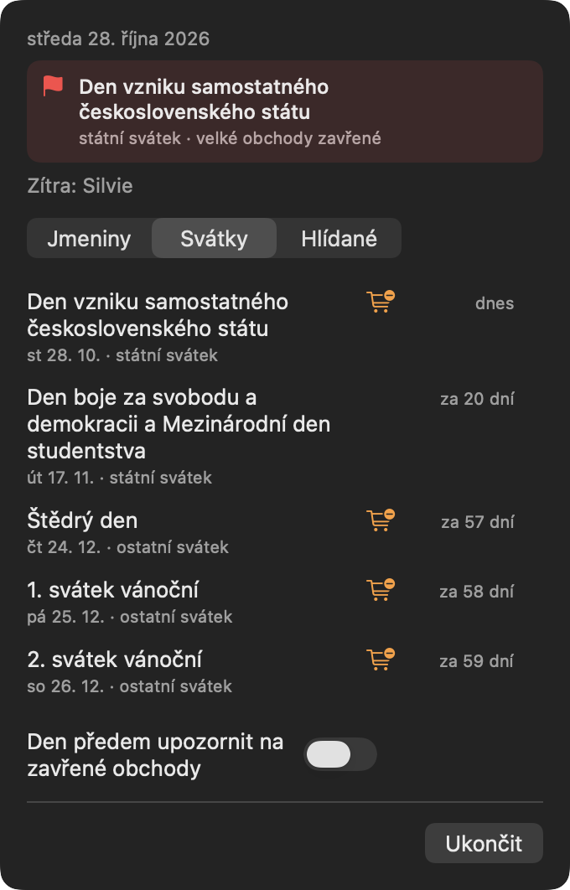

# SvátekTracker

*Kdo má dnes svátek — v menu baru tvého Macu.*

Native macOS menubar app (Apple Silicon) for Czech name days and public holidays.

<p>
  
  
</p>

- **Menu bar** shows who celebrates today — or the holiday on name-less days.
  A flag marks public holidays, a star a tracked name.
- **Click** for today in detail, the next 30 name days, the coming year's public
  holidays (with Easter computed), and which ones close large shops.
- **Track names** (search, then star) to get a reminder the evening before and
  the morning of their name day. Opt-in heads-up the evening before shops close.
- Rolls over at midnight and after sleep; right-click for launch at login.
- Updates itself via [Sparkle](https://sparkle-project.org).
- Everything is computed locally. The only network traffic is Sparkle's daily
  update check, which includes Sparkle's anonymous system profile (macOS
  version, CPU type) — no accounts, no analytics SDK.

## Install

**[Download the DMG](https://svatektracker.jsemkoder.cz)** — signed with
Developer ID and notarized; open it and drag the app to Applications. Requires
an Apple Silicon Mac with macOS 14+.

Or build from source (needs Xcode, Swift 6.2+):

```sh
git clone https://github.com/Hermanik/SvatekTracker.git
cd SvatekTracker
scripts/install.sh       # build, copy to /Applications, launch
```

A source build is signed with your Developer ID if one is in the keychain,
otherwise ad-hoc — fine for running it on your own Mac.

## Development

```sh
swift build
swift test                                   # core logic
swift run SvatekTracker                      # quick run (no reminders without a bundle)
mkdir -p /tmp/snap && SVATEKTRACKER_SNAPSHOT=/tmp/snap swift run   # panel → PNGs
swift format lint -r -s Sources Tests
```

`Sources/SvatekTrackerCore` holds all calendar logic with no system dependencies
and full test coverage; `Sources/SvatekTracker` is the AppKit/SwiftUI shell.
More in [CLAUDE.md](CLAUDE.md).

## Data

- **Name days** — the Czech civil name-day calendar (`NameDays.swift`).
- **Public holidays** — days off under zákon č. 245/2000 Sb., Good Friday and
  Easter Monday computed from Easter (`Holidays.swift`).
- **Shop closures** — shops over 200 m² under zákon č. 223/2016 Sb.

Spotted a wrong date? Open an issue or a PR with a source — and a test.

## License

[MIT](LICENSE)
